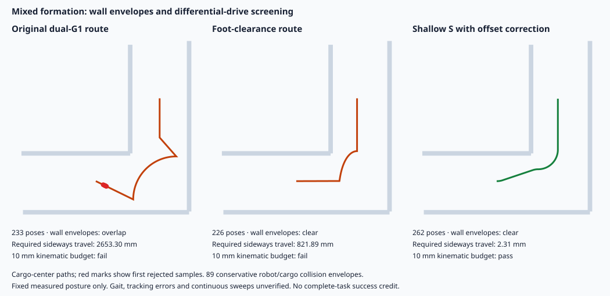
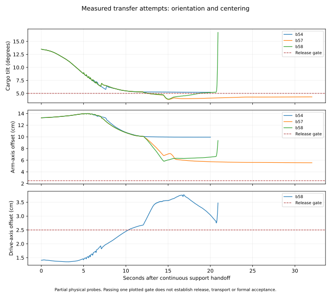

# M2 · 实施与验收记录

更新：2026-10-30。**六项配置中，M2-1、M2-3、M2-5、M2-6 共 4 项已有完整物理成功记录；M2-2、M2-4 仍未完成连续运输与释放。**局部承托、站起、规划筛查通过均不计完整任务成功。所有失败与不完整记录保留。

[任务页、视频与下载](../infra/task-m2-zh.html#m2-implementation) · [详细任务规格](m2-task-family.html) · [全部尝试与当前结果](../infra/planning/m2-extension/implementation-status.json) · [发布范围与未完成项](../infra/planning/m2-extension/acceptance/release-readiness.json)

## 六项任务与当前证据

| 配置 | 要验证的问题 | 已完成的物理证据 | 仍缺什么 |
| --- | --- | --- | --- |
| M2-1 · 双 G1，0.25 kg | 同构协同搬运基线 | 三次均连续完成抓取、起箱、转弯、运输、下放与释放，174.36 s；封存状态检查通过。 | 人工审阅与第二人独立复现。 |
| M2-2 · G1 + Stretch 3，0.25 kg | 异构形态能否分工搬运同一长物 | b88 从地面初态连续完成抓持、共同承托、调平、站起和短程搬运，107.74 s；实测位移 103.0 mm、终点静止 2.00 s。21,549 个封存状态记录检查、接触与自碰撞复核通过。 | 完整路线、下放与释放；30 cm 延长试验 b89 在 110.44 s 失去共同接触，仍未通过。 |
| M2-3 · 双 G1，0.5 kg | 固定形态和场景后的加重对照 | 三次完整成功：175.88、175.88、177.82 s；独立物理检查通过。 | 人工审阅与第二人独立复现；此前 1 kg 的三次失败保留。 |
| M2-4 · G1 + Stretch 3，0.5 kg | 异构直接搬运或工具辅助 | b33 在 90.84 s 完成共同承托、调平与站起；18,169 个封存状态及接触复核通过，躯干—手臂峰值 0 N。 | b46 已移动约 12 cm，但停车后双手脱离，105.08 s 失败；完整路线与释放未通过，工具分支尚未实现。 |
| M2-5 · 双 G1，0.5 kg + 可移动障碍 | 先清障再返回搬运职责 | c26/c27/c28 三次完整成功，均 259.74 s；代表记录含 51,949 个 200 Hz 状态，17 项检查通过，释放后共同保持 2.10 s。 | 人工审阅、第二人独立复现，以及与 M2-6 的同条件收益对照。 |
| M2-6 · 三 G1，同 M2-5 | 第三台负责清障能否减少角色切换 | b14/b15/b16 三次完整成功，均 257.96 s；代表记录含 51,593 个状态，17 项检查通过，终点保持 2.11 s。**计入同源码 b11/b12/b13 失败后，总体为 3/6。** | 跨环境稳定性、人工审阅与第二人复现；第三台无需全程抬箱。 |

Stretch 固定为 **Stretch 3 / SE3 / DW3 / SG3**。这些质量是当前仿真候选，不是硬件负载极限；失败不证明物理不可行。重复运行不是随机场景全覆盖，现有结果也不构成异构、工具或第三机器人收益的因果证明。

## 异构任务：已定位的问题与改动

**碰撞与参考姿态。**旧慢步规划漏查躯干—手臂碰撞：b71 的 200 Hz 接触峰值 162.18 N，旧参考本身存在穿透。补入约 12 mm 规划净空、手臂姿态跟踪及实际接触保护后，表中站立记录通过。原有 14 项记录检查不等于所有自碰撞均已检查。

**按当前状态规划。**站起和步态段从当时的实测姿态、关节与控制指令生成；输入、轨迹与冻结代码哈希可逐项核对。固定参考的 2 mm / 10 mrad 入口容差未放宽。站起计算约 16 秒、步态约 45–60 秒，计算期间仿真停步；没有状态重置或实时控制能力声明。

**重心转移与抬脚。**新增实际重心、足底载荷与持续稳定门槛，以及落脚确认、有限脚部卸载和有界平衡反馈。轻载 b81 在尚有约 16% 摆动脚载荷时安全超时；b82 小幅卸载后进入首次摆腿，仍于 102.66 s 触发碰撞保护。重载 b41/b42 将踝侧摆预留增加到 30 mrad 后保持无躯干接触，但约 10 mm 重心误差仍未满足 8 mm 抬脚门槛，100.84 s 停止。b43 调整关节支撑偏置后于 97.86 s 失去共同承托。

**持物姿态与控制交接。**低位直立轻载候选的夹持预紧力调整 b83、承托力反馈 b84 均未满足货物速度稳定条件。补充筛查发现，0.88 m 高度、无货物回撤、直立躯干的组合在两种载荷下均可行；此前失败的组合还同时包含 80 mm 回撤，不能只归因于高度。轻载 b86 已通过实际站立稳定门槛，但后续慢步参考手部误差约 15.9 mm，被拒绝执行。原 12 腿关节行走策略交接 b85 / b44 分别在 102.40 / 102.72 s 失去共同接触；包含腰部的 15 身体关节交接使轻载 b87 移动约 10 cm，但到达后仍追赶底盘位置误差，未满足停车稳定条件。

**短程搬运与停车。**按实际货物到达状态切换到现有平衡策略后，轻载 b88 首次通过 10 cm 探针。独立复核直接从 50 Hz 状态、双手接触和承重记录计算 2 秒终点保持，并结合 200 Hz 状态完整性与接触审计；完整任务状态仍为 false。重载 b46 在到达后失去抓持；轻载延长到 30 cm 的 b89 也未完成。首段 30 cm 曲线 b90 于 112.24 s 失去共同接触；重载 b47 随货物姿态调整抓持后在 92.88 s、尚未行走前失去接触，该组合被弃用。继续验证每 10 cm 稳停后推进，以及提高有限手臂参考跟踪速度的独立候选；不能由短程通过外推完整可行性。

以上均为前置阶段诊断。原始判定不改写，规划拒绝、物理失败和基础设施故障分开展示。

[站立轻载筛查](../infra/planning/m2-extension/acceptance/light-clear-stand-plan.json) · [站立重载筛查](../infra/planning/m2-extension/acceptance/heavy-clear-stand-plan.json) · [最新步态诊断与输入哈希](../infra/planning/m2-extension/acceptance/measured-gait-diagnosis.json) · [分段规划下载包校验](../infra/planning/m2-extension/acceptance/current-state-plan-bundles-review.json)

## 路线候选与历史交接

根据旧的实测站姿和冻结模型，以 89 个保守包络筛查整队路线。原双 G1 路线和固定队形偏置路线分别存在墙面净空或差速底盘横移要求；较浅 S 形圆弧候选对轻、重载分别通过 262 / 268 个采样姿态检查，横移残差 2.31 / 0.018 mm，低于预声明的 1 cm 筛查预算。新高位直立轻载姿态 b88 已重新筛查：274 个采样姿态无墙面包络重叠，差速横移残差 7.13 mm。曲线控制已加入沿弧长的队形位姿参考、身体转向、双腕同步和差速轮速跟踪，开始分段物理验证；采样筛查不证明连续扫掠、步态变化或跟踪误差下的可行性。

[新站姿路线筛查](../infra/planning/m2-extension/acceptance/light-high-stance-route-screen.json) · [轻载路线与模型来源](../infra/planning/m2-extension/acceptance/mixed-route-screen.json) · [重载路线筛查](../infra/planning/m2-extension/acceptance/mixed-route-heavy-screen.json)



<details markdown="1"><summary>早期交接诊断：均未完成撤手与独立承托</summary>

b54/b57/b58 的虚线表示撤手前局部门槛；旧记录缺失的纵向偏差未补造。后续交接的失稳与未居中超时也保留在实验台账中。



[数值与轨迹哈希](../infra/planning/m2-extension/acceptance/mixed-transfer-diagnostics.json)

</details>

## 每项任务的材料与对应关系

高层计划说明机器人职责和阶段目标；低层计划说明关节、底盘、接触反馈及退出条件。任务页把冻结计划与实际执行区间关联，未执行的阶段不计轨迹证据。较早的事后计划关联单独标注来源。

| 材料 | 内容与边界 |
| --- | --- |
| 专家源码、提交与模型清单 | 对应尝试的冻结代码、运行命令、环境和文件哈希；单独源码 ZIP 不包含全部大型模型资产。 |
| 高层/低层计划、阶段区间、状态轨迹 | 核对计划与执行。可视化轨迹通常为 50 Hz；物理与接触原始记录为 200 Hz。 |
| `planning-inputs.zip` | 冻结的规划输入，可能含未采用候选；不代替完整复核包。 |
| `executed-plans.zip` 与一致性报告 | 本次从观测生成的分段参考、被拒绝候选和输入—轨迹—代码哈希检查；筛查通过不代表执行成功。 |
| 接触、力矩、状态审计与视频 | 视频为 4 倍速，局部探针标明 prerequisite。封存状态重渲染只改善取景，不重跑或补造物理动作。 |
| 四项完整任务的复核包 | 冻结源码、资产与 200 Hz 记录；已在新解压目录做作者侧只读审计。其余原始记录清单只说明本地保存和哈希，不声称全部已公开下载。 |

[完整任务复核包](../infra/planning/m2-extension/acceptance/reproduction-kits.json) · [解压后审计](../infra/planning/m2-extension/acceptance/review-kit-validation.json)

## 物理规则与复现边界

所有运动经真实接触与有界执行器指令产生。运行中禁止重设机器人/货物姿态、隐形连接和外加物体力。清障接触规则与货物接触规则分开：声明的膝/踝可推障，搬运货物仍只允许手/腕接触。候选质量、接触规则与源码随提交冻结。

Stretch 伸缩部件内部碰撞壳的精确部件对排除，依据固定版本官方模型与 H6 接口说明；机器人对货物、地面、墙和其他机器人碰撞保留。G1 手指另查模型的 **1.4 / 2.45 Nm** 限矩，不以接口缺省 5 Nm 代替。超限探索、日志序列化故障和磁盘写满的记录均保留，并明确区别于物理不可行。

完整双/三 G1 参考使用 CPU 物理后端；早期异构探针曾用 GPU，后续 CPU 对照和不同节点分开记录。部分作者试验预加载第三方库，每次独立 fork 从冻结源码和地面初态开始；原始 `job.sh` 保留独立进程复现入口。该模式不是第二人复现。冻结 L1 评分器不支持新增三机器人配置，不能代替新配置的独立检查。专家使用仿真状态反馈，不是硬件、视觉输入或隔离 agent 能力证明。

## 正式验收与下一步

异构完整成功必须同时满足连续送达与释放、200 Hz 状态审计、接触复核和躯干—手臂接触复核。检查覆盖初态、非平凡位移、执行器上限、墙碰撞、货物非手接触、机器人稳定、终点容纳、地面承重及释放保持；障碍任务另查暂存区、接触部位与冲量。

当前 **78 项自动测试通过**。冻结沙盒历史套件为 46 项执行通过、12 项缺夹具跳过，本轮没有新的 Docker 隔离回放。正式政策要求的人工视频/判据审阅、第二人独立复现仍未签署，自动检查不代签。工程证据可公开审阅，六项正式验收尚未完成。

[M2-1 三次验证](../infra/planning/m2-extension/acceptance/M2-1-repeat-cohort.json) · [M2-3 三次验证](../infra/planning/m2-extension/acceptance/M2-3-repeat-cohort.json) · [M2-5 三次验证](../infra/planning/m2-extension/acceptance/M2-5-repeat-cohort.json) · [M2-6 全部六次同源码运行](../infra/planning/m2-extension/acceptance/M2-6-repeat-cohort.json) · [当前测试记录](../infra/planning/m2-extension/acceptance/family-verifier-tests.log) · [历史沙盒测试](../infra/planning/m2-extension/acceptance/frozen-sandbox-tests-package.log)

```sh
cd robo-si
# 只读审计，不重新模拟或更改原始判定
OPENBLAS_NUM_THREADS=1 python -m m2_extension.acceptance \
  m2_extension/M2-1/attempts/b02-repeat --out /tmp/m2-1-independent-audit.json
python -m unittest discover -s m2_extension/tests -v
```

物理复跑使用对应 `submission.json`、`source-manifest.json`、冻结源码和资产，输出到新目录。独立复现记录必须包含真实执行人、环境、命令、输出哈希、实际判定与视频审阅结果，未完成字段不预填。
