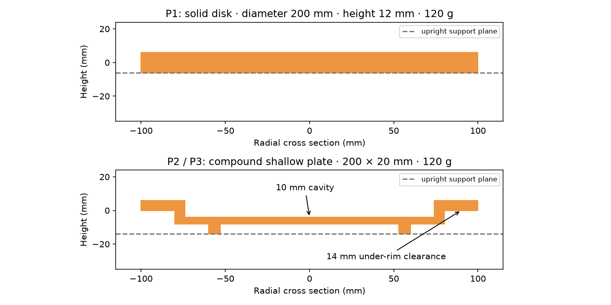
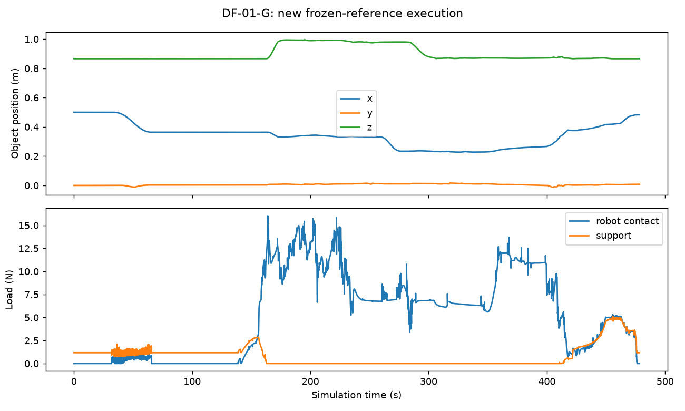

# Disk Flip: expert implementation and per-setting execution evidence

2026-10-29 · 4 variants · 3 embodiments · 6 settings

**Candidate experts and execution records exist for all six settings; 5/6 currently has a complete successful witness.** This round includes 140 physics executions, 3 setup failures, 2 independent original replays and four static support probes. Failed attempts do not prove infeasibility.

The revised original execution a03 spans 478.26 s, 23,913 controls, five high-level goals and 26 low-level segments. Its independent action replay passed. Historical 6/6 executions and 2/2 replays remain separate; formal admission remains false.

Inspire import correction: [audit](execution/acceptance/inspire-mimic-import-check.json). Retain the 12 official mimic linkages and remove 12 duplicates added by the adapter. Inertials, geometry, joint limits and actuators are unchanged. Historical failed F attempts retain their original models; the corrected importer requires fresh execution and replay.

## Formal acceptance progress

[Frozen acceptance plan](execution/acceptance/plan-v1.json) · [Exported status](execution/acceptance/status.json)

Development attempts are separate from qualification. Each setting needs a complete witness, a frozen controller, three fresh uninterrupted repetitions and independent replay. Failed repetitions cannot be replaced. Counterexamples, illegal-action checks, portable assets, process isolation, video review and second-person reproduction are also required. DF-01-G cohort-v1 passed three closed-loop runs but failed replay (1.99 s final stability and endpoint mismatch); it remains failed. Revised expert a03 pushes farther inside the unchanged goal region and passed a complete run and replay; cohort-v2 passed all three fresh runs and its independent replay. Extension cohort status is reported below; no human signoff is claimed. [Integration-step diagnostics](execution/acceptance/integration-convergence-audit.json) found a Stretch release failure at 400 Hz but successful unloading with smaller steps. Fresh 2,000 Hz development executions are running; checkpoint diagnostics are not full witnesses, and archived 400 Hz failures remain failures. Seven rejection/atomicity probes passed for each G/F/S action interface; separate-process G/F/S probes also reject seven illegal action classes atomically, and physical no-ops cannot satisfy the goal. These are boundary probes, not complete isolated task executions or an OS security sandbox. Inspire palm decomposition removes false convex-hull socket contacts while preserving official inertials.

[Original cohort-v1](execution/qualification/DF-01-G/cohort-v1/status.json) · [Original cohort-v2](execution/qualification/DF-01-G/cohort-v2/status.json) · Separate-process probes: [Dex3](execution/acceptance/isolated-boundary-G.json) / [Inspire](execution/acceptance/isolated-boundary-F.json) / [SG3](execution/acceptance/isolated-boundary-S.json)

Current frozen cohort cohort-v2: 3/3 fresh executions passed; independent replay passed.

DF-02-G [cohort-v1](execution/qualification/DF-02-G/cohort-v1/status.json): 3/3 fresh executions passed; independent replay passed.

DF-03-G [cohort-v1](execution/qualification/DF-03-G/cohort-v1/status.json): 3/3 fresh executions passed; independent replay passed.

DF-04-G [cohort-v1](execution/qualification/DF-04-G/cohort-v1/status.json): 3/3 fresh executions passed; independent replay passed.

DF-04-S [cohort-v1](execution/qualification/DF-04-S/cohort-v1/status.json): 3/3 fresh executions passed; independent replay passed.

4 additional runs were interrupted by shared-storage exhaustion. They count as infrastructure-incomplete, not physical failures or successes; [incident records](execution/acceptance/storage-incident-20261029.json) retain readable partial states. New attempts use fresh initial states and alternate output storage.

The original online closed-loop expert completed the task in a separate Python process, receiving read-only JSON observations and emitting 23,312 joint commands. The parent owns physics and scoring, with no shared simulator memory. Independent replay: passed. [Execution and rejection probes](execution/acceptance/original-isolated-closed-loop.json). This is privileged expert validation, not a public-agent score or OS sandbox.

[Download original expert reproduction bundle](https://github.com/wuxiyang1996/robo-si-review-assets/releases/download/disk-flip-evidence-20261029/disk-flip-original-expert-v2-b86c81b65bd4.tar.gz) · [Size, SHA-256 and scope](execution/acceptance/original-portable-download.json) · [Fresh portable-source execution](execution/acceptance/original-portable-validation.json). Includes robot assets/licenses, frozen expert/scorer, three repetitions, replay, process-isolated execution, trajectories, videos and commands.

| Setting | Automatic gates | Human video review | Second-person reproduction |
|---|---|---|---|
| DF-01-G | 10/10 | pending | pending |
| DF-02-G | 10/10 | pending | pending |
| DF-02-F | 0/10 | pending | pending |
| DF-03-G | 10/10 | pending | pending |
| DF-04-G | 10/10 | pending | pending |
| DF-04-S | 10/10 | pending | pending |

[Historical portable development scenes](https://github.com/wuxiyang1996/robo-si-review-assets/releases/download/site-evidence-20261028/disk-flip-development-scenes-557d1b1372ec.tar.gz) · [SHA-256 / scope](execution/acceptance/portable-download.json)

| Setting | Selected run | Result / stop reason | Duration | Hz | Replay |
|---|---|---|---|---|---|
| [DF-01-G](#df-01-g) | DF-01-G-a03 | success | 478.26 s | 400 | pass |
| [DF-02-G](#df-02-g) | DF-02-G-a33 | success | 581.22 s | 2000 | pass |
| [DF-02-F](#df-02-f) | DF-02-F-a38 | disk_angular_speed | 352.00 s | 2000 | pass |
| [DF-03-G](#df-03-g) | DF-03-G-a23 | success | 573.56 s | 2000 | pass |
| [DF-04-G](#df-04-g) | DF-04-G-a27 | success | 538.00 s | 2000 | pass |
| [DF-04-S](#df-04-s) | DF-04-S-a28 | success | 545.00 s | 2000 | pass |

## Implementation boundaries

DF-01 uses frozen original Genesis sources and scoring. Extensions use MuJoCo 3.14.0: selected historical extension records use 400 Hz physics; new development runs use 2,000 Hz. Both use 50 Hz control/trace and 10 fps video. Independent replay compares every qpos/qvel sample from a fresh initial state, and checks actuator limits, contact loads and high/low coverage. Replay agreement is not task success. Official G1 Dex3/Inspire bodies share the same 29-DOF base; Stretch 3 uses official SG3 geometry and linkage. Bases are fixed. All model adaptations and effort limits are recorded per run. No hardware or free-standing feasibility is claimed.

Extension start (0.40, 0) has 50 mm overhang at the x=0.35 m table edge; target is (0.50, 0), table height 0.86 m. Original DF-01 still pushes from (0.50, 0). G/F share the world and object; hand-specific controllers may differ. Stretch base placement changed during development. This is not a common-policy embodiment ranking.

Per-run plans declare linear/angular speed caps of 0.12 m/s and 0.65 rad/s; robot/table contact sums of 18/8 N; P3 additionally caps each contacting body at 4 N. Self/table collision loads above 20 N or unsupported time above 0.10 s fail. The goal requires ≤8° normal error, ≤45 mm planar error, whole-disk tabletop containment, full release and 2 s stability. P3 is a provisional rigid-body load proxy, not fracture simulation.

The executed candidate uses grasp–lift–turn–place. The final development scorer permits controlled supported turnover with lift only a diagnostic. Dex3 and Stretch development attempts have reached full inversion, and Stretch has reached inverted setdown. Support transfer, release and the final goal are checked independently for each setting; see the verified witness table. Edge regrasp, tangential compliance and load-based release are under development; no failed attempt is relabeled successful.

## Physical disk design

P1: 200 mm diameter, 12 mm thick, 120 g. P2/P3: 200 × 20 mm, 120 g; 4 mm floor, 6 mm rim over radii 79–100 mm, 10 mm cavity, support-ring radii 53–60 mm and height 6 mm, 14 mm under-rim clearance. Separate convex sectors retain the cavity/gaps; compound inertia is an approximation with overlapping components, not exact solid CAD. Object/table sliding friction is 0.7; effective hand friction also depends on imported contact parameters. Four 5 s upright/inverted static support probes passed (P1/P2, final 2 s stable). This is not a complete grasp/flip/release witness.

[Support probes](execution/plate-design/support-probes.json) · [All attempts](implementation.json) · [Controller](execution/source/run.py) · [Model](execution/source/model.py) · [Verifier](execution/source/verify.py)

## Per-setting plans, trajectories, physics and videos

<h3 id="df-01-g">DF-01-G · DF-01-G-a03</h3>

Complete success; independent action replay passed.

<video controls preload="none" playsinline poster="execution/DF-01-G-a03/initial.png" src="https://github.com/wuxiyang1996/robo-si-review-assets/releases/download/disk-flip-evidence-20261029/disk-flip-DF-01-G-a03-video-c6ee07dd6d2a.mp4"></video>

[Plan](execution/DF-01-G-a03/plan.json) · [High/low → trajectory](execution/DF-01-G-a03/high-low-trajectory.json) · [Verification](execution/DF-01-G-a03/verification.json) · [Summary](execution/DF-01-G-a03/summary.json) · [50 Hz trace / scope](execution/DF-01-G-a03/trace-scope.json) · [Video](https://github.com/wuxiyang1996/robo-si-review-assets/releases/download/disk-flip-evidence-20261029/disk-flip-DF-01-G-a03-video-c6ee07dd6d2a.mp4)

Trajectory: [trajectory.npz](https://github.com/wuxiyang1996/robo-si-review-assets/releases/download/disk-flip-evidence-20261029/disk-flip-DF-01-G-a03-trajectory-25b975cde9db.npz) · [SHA-256 / replay](execution/DF-01-G-a03/trajectory-download.json)

Trace: [trace-compact.jsonl.gz](https://github.com/wuxiyang1996/robo-si-review-assets/releases/download/disk-flip-evidence-20261029/disk-flip-DF-01-G-a03-trace-ad560cf63a8a.jsonl.gz)

[Frozen execution sources](https://github.com/wuxiyang1996/robo-si-review-assets/releases/download/disk-flip-evidence-20261029/disk-flip-DF-01-G-a03-sources-412ba7ab4917.tar.gz) · [External artifact hashes](execution/DF-01-G-a03/external-media.json)

| High level | Low level | Time (s) | State |
|---|---|---|---|
| slide | L01 · settle_raised_separated_hands | 0.00–4.50 | completed |
| slide | L02 · approach_far_rim | 4.50–12.50 | completed |
| slide | L03 · lower_outside_far_rim | 12.50–20.50 | completed |
| slide | L04 · gentle_rim_contact | 20.50–31.88 | completed |
| slide | L05 · slide_to_near_edge | 31.88–64.32 | completed |
| clamp | L06 · unload_rim_pusher | 64.32–69.82 | completed |
| clamp | L07 · clear_rim_pusher | 69.82–75.82 | completed |
| clamp | L08 · retract_above_and_beside_disk | 75.82–91.82 | completed |
| clamp | L09 · reconfigure_for_bimanual_approach | 91.82–107.82 | completed |
| clamp | L10 · calibrate_free_finger_preshape | 107.82–130.88 | completed |
| clamp | L11 · close_two_independent_edge_pinches | 130.88–161.42 | completed |
| lift | L12 · lift_with_two_edge_pinches | 161.42–172.80 | completed |
| turn | L13 · turn_with_two_edge_pinches | 172.80–222.92 | completed |
| place | L14 · settle_after_bimanual_inversion | 222.92–232.94 | completed |
| place | L15 · transfer_weight_to_one_pinch | 232.94–241.04 | completed |
| place | L16 · clear_bridge_pusher | 241.04–257.04 | completed |
| place | L17 · carry_inverted_disk_outside_edge | 257.04–277.04 | completed |
| place | L18 · lower_outside_holding_hand | 277.04–302.04 | completed |
| place | L19 · align_supported_disk_with_table_height | 302.04–305.20 | completed |
| place | L20 · approach_near_rim_above_outside_bridge | 305.20–323.20 | completed |
| place | L21 · lower_bridge_pusher_outside_near_rim | 323.20–335.20 | completed |
| place | L22 · establish_bridge_push_contact | 335.20–344.10 | completed |
| place | L23 · slide_disk_from_holding_hand_onto_table | 344.10–417.62 | completed |
| place | L24 · table_and_lower_pads_share_load_after_thumb_release | 417.62–417.64 | completed |
| place | L25 · withdraw_lower_pads_after_supported_centre | 417.64–474.42 | completed |
| place | L26 · unload_bridge_pusher | 474.42–478.26 | completed |

<h3 id="df-02-g">DF-02-G · DF-02-G-a33</h3>

Complete success; independent action replay passed.

Policy scope: fixed nominal joint-reference prefix followed by measured-state withdrawal. Every physics step is freshly executed and scored. This is a nominal physical witness, not a generalizing closed-loop policy.

[Portable frozen expert](https://github.com/wuxiyang1996/robo-si-review-assets/releases/download/disk-flip-evidence-20261029/disk-flip-DF-02-G-a33-portable-expert-32985ed3d933.tar.gz) · [SHA-256 / scope](execution/acceptance/portable-DF-02-G-download.json)

<video controls preload="none" playsinline poster="https://github.com/wuxiyang1996/robo-si-review-assets/releases/download/disk-flip-evidence-20261029/disk-flip-DF-02-G-a33-initial-1a4d11583263.png" src="https://github.com/wuxiyang1996/robo-si-review-assets/releases/download/disk-flip-evidence-20261029/disk-flip-DF-02-G-a33-video-7b3a5dfd523b.mp4"></video>

[Plan](execution/DF-02-G-a33/plan.json) · [High/low → trajectory](execution/DF-02-G-a33/high-low-trajectory.json) · [Verification](execution/DF-02-G-a33/verification.json) · [Summary](execution/DF-02-G-a33/summary.json) · [50 Hz trace / scope](execution/DF-02-G-a33/trace-scope.json) · [Video](https://github.com/wuxiyang1996/robo-si-review-assets/releases/download/disk-flip-evidence-20261029/disk-flip-DF-02-G-a33-video-7b3a5dfd523b.mp4)

Trajectory: [trajectory-reference.npz](https://github.com/wuxiyang1996/robo-si-review-assets/releases/download/disk-flip-evidence-20261029/disk-flip-DF-02-G-a33-trajectory-865012b431a1.npz) · [SHA-256 / replay](execution/DF-02-G-a33/trajectory-reference.json)

[Reference replay verification](execution/DF-02-G-a33/reference-replay-verification.json) · [Replay script](execution/source/compact_evidence.py)

Trace: [trace-compact.jsonl.gz](https://github.com/wuxiyang1996/robo-si-review-assets/releases/download/disk-flip-evidence-20261029/disk-flip-DF-02-G-a33-trace-2e19e89ef621.jsonl.gz)

[Frozen execution sources](https://github.com/wuxiyang1996/robo-si-review-assets/releases/download/disk-flip-evidence-20261029/disk-flip-DF-02-G-a33-sources-a55b72937fab.tar.gz) · [External artifact hashes](execution/DF-02-G-a33/external-media.json)

| High level | Low level | Time (s) | State |
|---|---|---|---|
| prepare | L01 · settle | 0.00–2.00 | completed |
| grasp | L12 · edge_slide | 2.00–87.58 | completed |
| prepare | L02 · preshape | 87.58–91.58 | completed |
| prepare | L03 · orient_clear | 91.58–107.58 | completed |
| grasp | L04 · pregrasp | 107.58–111.58 | completed |
| grasp | L05 · insert | 111.58–139.58 | completed |
| grasp | L06 · close | 139.58–189.58 | completed |
| lift | L07 · lift | 189.58–229.58 | completed |
| turn | L08 · turn | 229.58–302.12 | completed |
| place | L09 · place | 302.12–313.42 | completed |
| place | L09 · place | 313.42–329.42 | completed |
| place | L09 · place | 329.42–344.42 | completed |
| place | L09 · place | 344.42–384.42 | completed |
| place | L09 · place | 384.42–394.42 | completed |
| place | L09 · place | 394.42–424.42 | completed |
| place | L09 · place | 424.42–449.42 | completed |
| place | L09 · place | 449.42–450.26 | completed |
| place | L09 · place | 450.26–460.26 | completed |
| place | L09 · place | 460.26–466.26 | completed |
| place | L11 · slide_goal | 466.26–486.26 | completed |
| place | L11 · slide_goal | 486.26–498.26 | completed |
| place | L11 · slide_goal | 498.26–528.34 | completed |
| place | L11 · slide_goal | 528.34–532.34 | completed |
| place | L11 · slide_goal | 532.34–535.34 | completed |
| place | L11 · slide_goal | 535.34–543.34 | completed |
| place | L11 · slide_goal | 543.34–548.34 | completed |
| place | L11 · slide_goal | 548.34–570.72 | completed |
| place | L10 · release | 570.72–574.72 | completed |
| place | L10 · release | 574.72–578.72 | completed |
| place | L10 · release | 578.72–581.22 | completed |

<h3 id="df-02-f">DF-02-F · DF-02-F-a38</h3>

Failed candidate: `disk_angular_speed` at 352.00 s. No complete feasibility witness yet.

<video controls preload="none" playsinline poster="https://github.com/wuxiyang1996/robo-si-review-assets/releases/download/disk-flip-evidence-20261029/disk-flip-DF-02-F-a38-initial-a89b12005427.png" src="https://github.com/wuxiyang1996/robo-si-review-assets/releases/download/disk-flip-evidence-20261029/disk-flip-DF-02-F-a38-video-dcfbb299e847.mp4"></video>

[Plan](execution/DF-02-F-a38/plan.json) · [High/low → trajectory](execution/DF-02-F-a38/high-low-trajectory.json) · [Verification](execution/DF-02-F-a38/verification.json) · [Summary](execution/DF-02-F-a38/summary.json) · [50 Hz trace / scope](execution/DF-02-F-a38/trace-scope.json) · [Video](https://github.com/wuxiyang1996/robo-si-review-assets/releases/download/disk-flip-evidence-20261029/disk-flip-DF-02-F-a38-video-dcfbb299e847.mp4)

Trajectory: [trajectory-reference.npz](https://github.com/wuxiyang1996/robo-si-review-assets/releases/download/disk-flip-evidence-20261029/disk-flip-DF-02-F-a38-trajectory-212d1a874cd2.npz) · [SHA-256 / replay](execution/DF-02-F-a38/trajectory-reference.json)

[Reference replay verification](execution/DF-02-F-a38/reference-replay-verification.json) · [Replay script](execution/source/compact_evidence.py)

Trace: [trace-compact.jsonl.gz](https://github.com/wuxiyang1996/robo-si-review-assets/releases/download/disk-flip-evidence-20261029/disk-flip-DF-02-F-a38-trace-c91b5e977f0d.jsonl.gz)

[Frozen execution sources](https://github.com/wuxiyang1996/robo-si-review-assets/releases/download/disk-flip-evidence-20261029/disk-flip-DF-02-F-a38-sources-84a2e1745840.tar.gz) · [External artifact hashes](execution/DF-02-F-a38/external-media.json)

| High level | Low level | Time (s) | State |
|---|---|---|---|
| prepare | L01 · settle | 0.00–2.00 | completed |
| grasp | L12 · edge_slide | 2.00–8.00 | completed |
| grasp | L12 · edge_slide | 8.00–18.00 | completed |
| grasp | L12 · edge_slide | 18.00–34.00 | completed |
| grasp | L12 · edge_slide | 34.00–46.00 | completed |
| grasp | L12 · edge_slide | 46.00–54.00 | completed |
| grasp | L12 · edge_slide | 54.00–90.60 | completed |
| grasp | L12 · edge_slide | 90.60–100.60 | completed |
| grasp | L12 · edge_slide | 100.60–112.60 | completed |
| prepare | L03 · orient_clear | 112.60–126.60 | completed |
| prepare | L02 · preshape | 126.60–130.60 | completed |
| prepare | L03 · orient_clear | 130.60–146.60 | completed |
| grasp | L04 · pregrasp | 146.60–150.60 | completed |
| prepare | L03 · orient_clear | 150.60–162.60 | completed |
| grasp | L05 · insert | 162.60–202.60 | completed |
| grasp | L05 · insert | 202.60–210.60 | completed |
| grasp | L06 · close | 210.60–310.60 | completed |
| grasp | L06 · close | 310.60–310.88 | completed |
| lift | L07 · lift | 310.88–350.88 | completed |
| turn | L08 · turn | 350.88–352.00 | interrupted |

Unexecuted planned actions are not shown as completed; see plan.json for the full candidate.

<h3 id="df-03-g">DF-03-G · DF-03-G-a23</h3>

Complete success; independent action replay passed.

Policy scope: fixed nominal joint-reference prefix followed by measured-state withdrawal. Every physics step is freshly executed and scored. This is a nominal physical witness, not a generalizing closed-loop policy.

[Portable frozen expert](https://github.com/wuxiyang1996/robo-si-review-assets/releases/download/disk-flip-evidence-20261029/disk-flip-DF-03-G-a23-portable-expert-8b56fc7eeb32.tar.gz) · [SHA-256 / scope](execution/acceptance/portable-DF-03-G-download.json)

<video controls preload="none" playsinline poster="https://github.com/wuxiyang1996/robo-si-review-assets/releases/download/disk-flip-evidence-20261029/disk-flip-DF-03-G-a23-initial-216d0fa10a14.png" src="https://github.com/wuxiyang1996/robo-si-review-assets/releases/download/disk-flip-evidence-20261029/disk-flip-DF-03-G-a23-video-b1bc5ca37fdf.mp4"></video>

[Plan](execution/DF-03-G-a23/plan.json) · [High/low → trajectory](execution/DF-03-G-a23/high-low-trajectory.json) · [Verification](execution/DF-03-G-a23/verification.json) · [Summary](execution/DF-03-G-a23/summary.json) · [50 Hz trace / scope](execution/DF-03-G-a23/trace-scope.json) · [Video](https://github.com/wuxiyang1996/robo-si-review-assets/releases/download/disk-flip-evidence-20261029/disk-flip-DF-03-G-a23-video-b1bc5ca37fdf.mp4)

Trajectory: [trajectory-reference.npz](https://github.com/wuxiyang1996/robo-si-review-assets/releases/download/disk-flip-evidence-20261029/disk-flip-DF-03-G-a23-trajectory-5dffc1b818f8.npz) · [SHA-256 / replay](execution/DF-03-G-a23/trajectory-reference.json)

[Reference replay verification](execution/DF-03-G-a23/reference-replay-verification.json) · [Replay script](execution/source/compact_evidence.py)

Trace: [trace-compact.jsonl.gz](https://github.com/wuxiyang1996/robo-si-review-assets/releases/download/disk-flip-evidence-20261029/disk-flip-DF-03-G-a23-trace-83e2874bf423.jsonl.gz)

[Frozen execution sources](https://github.com/wuxiyang1996/robo-si-review-assets/releases/download/disk-flip-evidence-20261029/disk-flip-DF-03-G-a23-sources-07de2c36228a.tar.gz) · [External artifact hashes](execution/DF-03-G-a23/external-media.json)

| High level | Low level | Time (s) | State |
|---|---|---|---|
| prepare | L01 · settle | 0.00–2.00 | completed |
| grasp | L12 · edge_slide | 2.00–87.60 | completed |
| prepare | L02 · preshape | 87.60–91.60 | completed |
| prepare | L03 · orient_clear | 91.60–107.60 | completed |
| grasp | L04 · pregrasp | 107.60–111.60 | completed |
| grasp | L05 · insert | 111.60–139.60 | completed |
| grasp | L06 · close | 139.60–189.60 | completed |
| lift | L07 · lift | 189.60–229.60 | completed |
| turn | L08 · turn | 229.60–292.00 | completed |
| place | L09 · place | 292.00–332.10 | completed |
| place | L09 · place | 332.10–348.10 | completed |
| place | L09 · place | 348.10–363.10 | completed |
| place | L09 · place | 363.10–403.10 | completed |
| place | L09 · place | 403.10–413.10 | completed |
| place | L09 · place | 413.10–443.10 | completed |
| place | L09 · place | 443.10–444.10 | completed |
| place | L09 · place | 444.10–450.10 | completed |
| place | L09 · place | 450.10–459.06 | completed |
| place | L09 · place | 459.06–469.06 | completed |
| place | L09 · place | 469.06–475.06 | completed |
| place | L11 · slide_goal | 475.06–495.06 | completed |
| place | L11 · slide_goal | 495.06–507.06 | completed |
| place | L11 · slide_goal | 507.06–533.70 | completed |
| place | L11 · slide_goal | 533.70–537.70 | completed |
| place | L11 · slide_goal | 537.70–541.70 | completed |
| place | L11 · slide_goal | 541.70–560.56 | completed |
| place | L10 · release | 560.56–565.56 | completed |
| place | L10 · release | 565.56–570.56 | completed |
| place | L10 · release | 570.56–573.56 | completed |

<h3 id="df-04-g">DF-04-G · DF-04-G-a27</h3>

Complete success; independent action replay passed.

Policy scope: fixed nominal joint-reference prefix followed by measured-state withdrawal. Every physics step is freshly executed and scored. This is a nominal physical witness, not a generalizing closed-loop policy.

[Portable frozen expert](https://github.com/wuxiyang1996/robo-si-review-assets/releases/download/disk-flip-evidence-20261029/disk-flip-DF-04-G-a27-portable-expert-6e89b83a31ed.tar.gz) · [SHA-256 / scope](execution/acceptance/portable-DF-04-G-download.json)

<video controls preload="none" playsinline poster="https://github.com/wuxiyang1996/robo-si-review-assets/releases/download/disk-flip-evidence-20261029/disk-flip-DF-04-G-a27-initial-41704ef98c91.png" src="https://github.com/wuxiyang1996/robo-si-review-assets/releases/download/disk-flip-evidence-20261029/disk-flip-DF-04-G-a27-video-92398ea55486.mp4"></video>

[Plan](execution/DF-04-G-a27/plan.json) · [High/low → trajectory](execution/DF-04-G-a27/high-low-trajectory.json) · [Verification](execution/DF-04-G-a27/verification.json) · [Summary](execution/DF-04-G-a27/summary.json) · [50 Hz trace / scope](execution/DF-04-G-a27/trace-scope.json) · [Video](https://github.com/wuxiyang1996/robo-si-review-assets/releases/download/disk-flip-evidence-20261029/disk-flip-DF-04-G-a27-video-92398ea55486.mp4)

Trajectory: [trajectory-reference.npz](https://github.com/wuxiyang1996/robo-si-review-assets/releases/download/disk-flip-evidence-20261029/disk-flip-DF-04-G-a27-trajectory-ceab2a2d6303.npz) · [SHA-256 / replay](execution/DF-04-G-a27/trajectory-reference.json)

[Reference replay verification](execution/DF-04-G-a27/reference-replay-verification.json) · [Replay script](execution/source/compact_evidence.py)

Trace: [trace-compact.jsonl.gz](https://github.com/wuxiyang1996/robo-si-review-assets/releases/download/disk-flip-evidence-20261029/disk-flip-DF-04-G-a27-trace-1163a063c250.jsonl.gz)

[Frozen execution sources](https://github.com/wuxiyang1996/robo-si-review-assets/releases/download/disk-flip-evidence-20261029/disk-flip-DF-04-G-a27-sources-c618e98bc92b.tar.gz) · [External artifact hashes](execution/DF-04-G-a27/external-media.json)

| High level | Low level | Time (s) | State |
|---|---|---|---|
| prepare | L01 · settle | 0.00–2.00 | completed |
| grasp | L12 · edge_slide | 2.00–88.10 | completed |
| prepare | L02 · preshape | 88.10–92.10 | completed |
| prepare | L03 · orient_clear | 92.10–108.10 | completed |
| grasp | L04 · pregrasp | 108.10–112.10 | completed |
| grasp | L05 · insert | 112.10–140.10 | completed |
| grasp | L06 · close | 140.10–190.10 | completed |
| lift | L07 · lift | 190.10–230.10 | completed |
| turn | L08 · turn | 230.10–290.10 | completed |
| place | L09 · place | 290.10–321.88 | completed |
| place | L09 · place | 321.88–361.88 | completed |
| place | L09 · place | 361.88–367.88 | completed |
| place | L09 · place | 367.88–422.88 | completed |
| place | L09 · place | 422.88–430.88 | completed |
| place | L09 · place | 430.88–440.88 | completed |
| place | L09 · place | 440.88–446.88 | completed |
| place | L11 · slide_goal | 446.88–466.88 | completed |
| place | L11 · slide_goal | 466.88–478.88 | completed |
| place | L11 · slide_goal | 478.88–525.00 | completed |
| place | L10 · release | 525.00–530.00 | completed |
| place | L10 · release | 530.00–535.00 | completed |
| place | L10 · release | 535.00–538.00 | completed |

<h3 id="df-04-s">DF-04-S · DF-04-S-a28</h3>

Complete success; independent action replay passed.

Policy scope: fixed nominal joint-reference prefix followed by measured-state withdrawal. Every physics step is freshly executed and scored. This is a nominal physical witness, not a generalizing closed-loop policy.

Additional complete witness: **DF-04-S-a27 · online expert · 546.06 s**. Independent native and compact-reference replays passed; the frozen qualification cohort remains separately tracked.

[Video](https://github.com/wuxiyang1996/robo-si-review-assets/releases/download/disk-flip-evidence-20261029/disk-flip-DF-04-S-a27-video-f9a2112d1847.mp4) · [Plan](execution/attempts/DF-04-S-a27/plan.json) · [High/low → trajectory](execution/attempts/DF-04-S-a27/high-low-trajectory.json) · [Verification](execution/attempts/DF-04-S-a27/verification.json) · [Reference replay](execution/attempts/DF-04-S-a27/reference-replay-verification.json) · [Trajectory](https://github.com/wuxiyang1996/robo-si-review-assets/releases/download/disk-flip-evidence-20261029/disk-flip-DF-04-S-a27-trajectory-4eecd0659823.npz) · [Frozen sources](https://github.com/wuxiyang1996/robo-si-review-assets/releases/download/disk-flip-evidence-20261029/disk-flip-DF-04-S-a27-sources-d01a031f02cb.tar.gz) · [SHA-256](execution/attempts/DF-04-S-a27/external-media.json)

[Portable frozen expert](https://github.com/wuxiyang1996/robo-si-review-assets/releases/download/disk-flip-evidence-20261029/disk-flip-DF-04-S-a28-portable-expert-aa5e669826c2.tar.gz) · [SHA-256 / scope](execution/acceptance/portable-DF-04-S-download.json)

<video controls preload="none" playsinline poster="https://github.com/wuxiyang1996/robo-si-review-assets/releases/download/disk-flip-evidence-20261029/disk-flip-DF-04-S-a28-initial-916d4d0c5cd2.png" src="https://github.com/wuxiyang1996/robo-si-review-assets/releases/download/disk-flip-evidence-20261029/disk-flip-DF-04-S-a28-video-652723adcfaf.mp4"></video>

[Plan](execution/DF-04-S-a28/plan.json) · [High/low → trajectory](execution/DF-04-S-a28/high-low-trajectory.json) · [Verification](execution/DF-04-S-a28/verification.json) · [Summary](execution/DF-04-S-a28/summary.json) · [50 Hz trace / scope](execution/DF-04-S-a28/trace-scope.json) · [Video](https://github.com/wuxiyang1996/robo-si-review-assets/releases/download/disk-flip-evidence-20261029/disk-flip-DF-04-S-a28-video-652723adcfaf.mp4)

Trajectory: [trajectory-reference.npz](https://github.com/wuxiyang1996/robo-si-review-assets/releases/download/disk-flip-evidence-20261029/disk-flip-DF-04-S-a28-trajectory-7ee2381c5767.npz) · [SHA-256 / replay](execution/DF-04-S-a28/trajectory-reference.json)

[Reference replay verification](execution/DF-04-S-a28/reference-replay-verification.json) · [Replay script](execution/source/compact_evidence.py)

Trace: [trace-compact.jsonl.gz](https://github.com/wuxiyang1996/robo-si-review-assets/releases/download/disk-flip-evidence-20261029/disk-flip-DF-04-S-a28-trace-1758b592c579.jsonl.gz)

[Frozen execution sources](https://github.com/wuxiyang1996/robo-si-review-assets/releases/download/disk-flip-evidence-20261029/disk-flip-DF-04-S-a28-sources-0c0aaa3ff792.tar.gz) · [External artifact hashes](execution/DF-04-S-a28/external-media.json)

| High level | Low level | Time (s) | State |
|---|---|---|---|
| prepare | L01 · settle | 0.00–2.00 | completed |
| prepare | L02 · preshape | 2.00–6.00 | completed |
| prepare | L03 · orient_clear | 6.00–18.00 | completed |
| grasp | L04 · pregrasp | 18.00–32.00 | completed |
| grasp | L05 · insert | 32.00–60.00 | completed |
| grasp | L06 · close | 60.00–105.00 | completed |
| grasp | L12 · edge_slide | 105.00–131.96 | completed |
| grasp | L13 · regrasp_release | 131.96–155.96 | completed |
| grasp | L04 · pregrasp | 155.96–181.96 | completed |
| grasp | L05 · insert | 181.96–205.96 | completed |
| grasp | L06 · close | 205.96–246.70 | completed |
| lift | L07 · lift | 246.70–286.70 | completed |
| turn | L08 · turn | 286.70–346.70 | completed |
| place | L09 · place | 346.70–378.74 | completed |
| place | L10 · release | 378.74–412.10 | completed |
| place | L11 · slide_goal | 412.10–520.00 | completed |
| place | L10 · release | 520.00–536.00 | completed |
| place | L10 · release | 536.00–542.00 | completed |
| place | L10 · release | 542.00–545.00 | completed |

## Remaining work and reproduction

Resolve hand-specific approach and force closure, preserve safe P2/P3 load margin, and complete turnover, support transfer and withdrawal for dual/single-arm candidates. Full witnesses are needed before protocol freeze, paired comparisons and initial-condition robustness tests. All privileged expert artifacts remain author-only and excluded from agent bundles.

To fit hosting limits, extension downloads retain every held 50 Hz reference and endpoint object state. The replay script reconstructs all joint states and actuator controls at each scene’s declared 400 / 2,000 Hz rate; every reconstructed array SHA-256 matches the original execution (see each linked report). Original DF-01 retains its native control trajectory. Public traces retain 50 Hz object states and aggregate loads, omitting repetitive individual contact lists. Full original NPZ/JSONL files remain unchanged in local df_family/runs/. A separate portable development bundle contains five extension scenes, 299 deduplicated assets, relative paths and upstream licenses; compiled physical arrays match the originals. It is a development scene bundle, not a qualified expert bundle. Archived per-run scenes retain their original paths.
