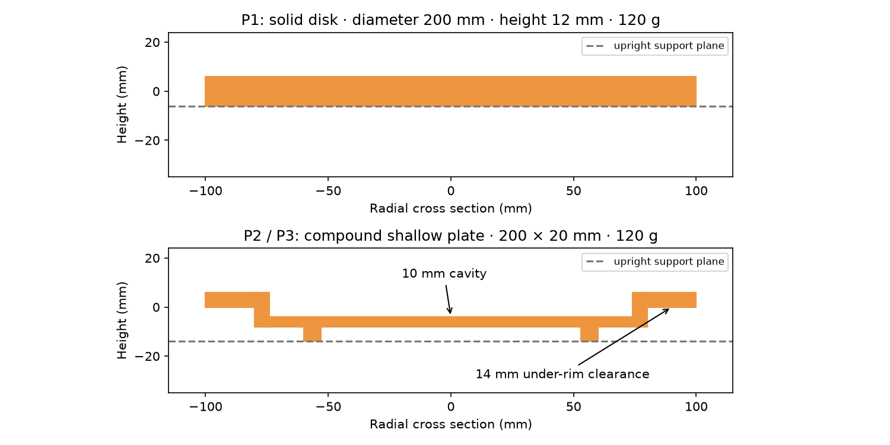
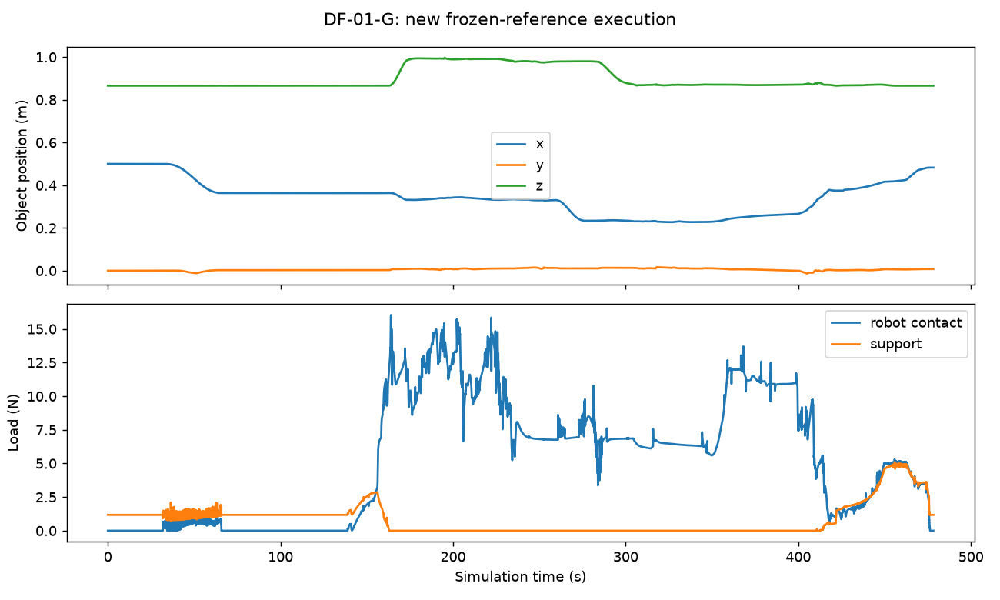

# Disk Flip：专家实现与逐项执行证据

2026-10-29 · 4 variants · 3 embodiments · 6 settings

**已为 6 个配置实现候选专家与执行记录；完整成功见证目前为 5/6。** 本轮共 140 次有物理轨迹的专家执行、3 次启动失败；另有 2 次原版独立动作回放和 4 次静态支撑探针。只把完整成功且独立验证通过的执行称作成功解。失败录像展示真实问题，不证明该配置不可行。

原版 DF-01-G 修订执行 a03 为 478.26 s，23,913 个控制步、5 个高层目标、26 个低层动作段，独立回放通过。新证据单列，不改写历史 6/6 执行、2/2 回放的统计。正式准入仍为 false。

Inspire 导入修正：[核对记录](execution/acceptance/inspire-mimic-import-check.json)。保留官方 12 条 mimic 联动约束，去掉导入器重复添加的 12 条；惯量、几何、关节限位和执行器数组不变。历史 F 失败尝试保留旧模型，新模型必须重新完成完整运行与回放。

## 正式验收进度

[固定验收方案](execution/acceptance/plan-v1.json) · [实时导出状态](execution/acceptance/status.json)

全部开发尝试与正式重复队列分开。每个配置须先完成全流程见证，再冻结控制器、连续执行 3 次新运行并独立回放；失败重复不能替换。还需反例与非法动作检查、便携资产、隔离动作接口、视频复核和第二人复现。DF-01-G 的 cohort-v1 三次闭环执行成功，但独立回放失败（稳定时间 1.99 s，且末态偏差超出容差），该队列保留为未通过。修订专家 a03 继续推至目标区内部后再释放，完整执行与独立回放均通过；其 cohort-v2 的三次新运行与独立回放均已通过。扩展配置的冻结队列与通过数量见下表；没有人工签字。

冻结原版评分器的 [38 项反例与回归检查](execution/acceptance/original-frozen-scorer-checks.json)通过；这些是评分器与几何检查，不是物理成功执行。

新增[积分步长诊断](execution/acceptance/integration-convergence-audit.json)：同一 Stretch 撤手检查点在 400 Hz 下出现角速度超限，在更小步长下完成卸载。已启动 2,000 Hz 的完整开发重跑；该局部诊断不计作全任务成功，旧 400 Hz 失败记录不改写。

G/F/S 动作接口已分别通过 7 类拒绝与原子提交探针；此外，三种手型均通过独立 Python 进程发送的 7 类非法动作测试，拒绝后物理状态与参考保持不变，3 s 无动作测试不会误报成功。这些仍是边界探针，不是完整任务的隔离执行或操作系统安全沙箱。Inspire 手掌碰撞体已按官方网格分解，消除了单凸包填满拇指关节槽导致的假碰撞，质量与惯性保持不变。

[原版 cohort-v1](execution/qualification/DF-01-G/cohort-v1/status.json) · [原版 cohort-v2](execution/qualification/DF-01-G/cohort-v2/status.json) · 独立进程探针：[Dex3](execution/acceptance/isolated-boundary-G.json) / [Inspire](execution/acceptance/isolated-boundary-F.json) / [SG3](execution/acceptance/isolated-boundary-S.json)

当前冻结队列 cohort-v2：新运行 3/3 通过；独立回放 passed。

DF-02-G [cohort-v1](execution/qualification/DF-02-G/cohort-v1/status.json)：新运行 3/3 通过；独立回放 passed。

DF-03-G [cohort-v1](execution/qualification/DF-03-G/cohort-v1/status.json)：新运行 3/3 通过；独立回放 passed。

DF-04-G [cohort-v1](execution/qualification/DF-04-G/cohort-v1/status.json)：新运行 3/3 通过；独立回放 passed。

DF-04-S [cohort-v1](execution/qualification/DF-04-S/cohort-v1/status.json)：新运行 3/3 通过；独立回放 passed。

另有 4 次运行因共享存储写满而未完成，另记为基础设施中断，不计为任务物理失败或成功；[事故记录](execution/acceptance/storage-incident-20261029.json)保留最后可读状态。替代输出目录中的新尝试从初态重跑。

原版闭环专家已在独立 Python 进程中完成全任务：通过 JSON 接收只读状态，在线产生 23,312 次关节目标；物理与评分由父进程持有，无共享仿真内存。该执行的独立回放：通过。[执行与边界探针报告](execution/acceptance/original-isolated-closed-loop.json)。这仍是特权专家验证，不是公开智能体成绩或操作系统安全沙箱。

[下载原版专家复现包](https://github.com/wuxiyang1996/robo-si-review-assets/releases/download/disk-flip-evidence-20261029/disk-flip-original-expert-v2-b86c81b65bd4.tar.gz) · [大小、SHA-256 与范围](execution/acceptance/original-portable-download.json) · [便携源码全流程运行验证](execution/acceptance/original-portable-validation.json)。包内含机器人资产及许可证、冻结专家与评分器、三次重复、独立回放、隔离执行、轨迹、视频和复现命令。

| 配置 | 自动验收门槛 | 人工视频复核 | 第二人复现 |
|---|---|---|---|
| DF-01-G | 10/10 | 待完成 | 待完成 |
| DF-02-G | 10/10 | 待完成 | 待完成 |
| DF-02-F | 0/10 | 待完成 | 待完成 |
| DF-03-G | 10/10 | 待完成 | 待完成 |
| DF-04-G | 10/10 | 待完成 | 待完成 |
| DF-04-S | 10/10 | 待完成 | 待完成 |

[Historical portable development scenes](https://github.com/wuxiyang1996/robo-si-review-assets/releases/download/site-evidence-20261028/disk-flip-development-scenes-557d1b1372ec.tar.gz) · [SHA-256 / scope](execution/acceptance/portable-download.json)

| Setting | 选定执行 | 结果 / 中止原因 | 时长 | Hz | 独立回放 |
|---|---|---|---|---|---|
| [DF-01-G](#df-01-g) | DF-01-G-a03 | 完整成功 | 478.26 s | 400 | 通过 |
| [DF-02-G](#df-02-g) | DF-02-G-a33 | 完整成功 | 581.22 s | 2000 | 通过 |
| [DF-02-F](#df-02-f) | DF-02-F-a38 | disk_angular_speed | 352.00 s | 2000 | 通过 |
| [DF-03-G](#df-03-g) | DF-03-G-a23 | 完整成功 | 573.56 s | 2000 | 通过 |
| [DF-04-G](#df-04-g) | DF-04-G-a27 | 完整成功 | 538.00 s | 2000 | 通过 |
| [DF-04-S](#df-04-s) | DF-04-S-a28 | 完整成功 | 545.00 s | 2000 | 通过 |

## 实现与物理边界

原版从已有发布证据冻结源码，保持 Genesis 原评分器、资产与限制；专家修订另存冻结版本。扩展使用 MuJoCo 3.14.0，扩展证据包含历史 400 Hz 与新 2,000 Hz 执行，逐条频率见上表；均为 50 Hz 控制/状态记录、10 fps 视频。独立验证器从初始状态重放记录的执行器控制，逐步比较 qpos/qvel，检查载荷、速度、执行器限制和高低层轨迹覆盖；回放匹配不代表任务成功。

G/F 使用官方同一 G1 29-DOF 身体、分别绑定 Dex3 / Inspire DFQ 手。Inspire 关节耦合保留；Stretch 使用官方 Stretch 3 + SG3 资产、原传动及手指耦合。基座固定。扩展身体使用有界执行器；仅初始化设置状态，策略执行不写盘体位置/速度、不开对象焊接、不施加外部搬运力。转换适配与固定骨盆相邻外壳的碰撞排除写入各 run 的 model-binding.json。此证据不支持自由站立或硬件可行性的结论。

新场景共同使用 0.86 m 高桌面、近边 x=0.35 m、盘中心起点 (0.40, 0)、目标 (0.50, 0)。这是已有 50 mm 悬伸的开发场景；原版仍从 (0.50, 0) 推到边缘。G/F 的场景与物体保持相同；控制器可因手型调整。Stretch 起始站位迭代过，逐次 scene.xml 留档。当前结果不是统一策略的身体性能排名。

扩展阈值在各次 plan.json 中声明：盘线速度 ≤0.12 m/s、角速度 ≤0.65 rad/s、机器人总接触载荷 ≤18 N、桌面总载荷 ≤8 N；P3 每个接触刚体对盘的载荷模长之和 ≤4 N。机器人自接触与桌碰总载荷各 ≤20 N；失去全部支撑 >0.10 s 即失败。目标面偏差 ≤8°、目标平面误差 ≤45 mm、全盘位于桌面、无手接触、稳定 2 s。P3 的 4 N 是待完整见证校准的刚体损伤代理，不是材料断裂模型。

当前执行候选采用“抓持—抬升—翻转—放回”路径。最终开发评分器允许受控桌面翻转，lift 标志只作为诊断；本轮存档候选仍要求先抬升，Dex3 与 Stretch 的开发执行已观察到完整翻面，Stretch 进一步做到倒扣落桌；支撑交接、撤手及最终目标按配置单独验证，完整成功状态见上表。已增加桌边重抓、切向柔顺和按载荷交接的控制分支，失败阈值保持不变。

## 盘体设计已落实到碰撞几何

- P1：直径 200 mm、厚 12 mm、质量 120 g。
- P2/P3：外径 200 mm、总高 20 mm、质量 120 g；盘底厚 4 mm；薄沿厚 6 mm，径向范围 79–100 mm；盘腔深 10 mm。底部支撑圈半径 53–60 mm、高 6 mm，形成 14 mm 沿下净空。
- 浅盘由底面与 32 段壁/沿/支撑圈凸体组合，保留凹腔和间隙；惯性为组合几何近似，局部重叠不代表精确实体 CAD。盘/桌的滑动摩擦系数设为 0.7，实际手接触还受官方手几何的接触混合参数影响，见 scene.xml。
- P1/P2 正放、倒扣各进行 5 s 无抓持支撑测试，末 2 s 稳定：4/4 通过。P3 复用 P2 几何。该探针仅验证支撑姿态；抓持、翻转和撤手仍须完成全流程验证。

[静态探针数值](execution/plate-design/support-probes.json) · [全部尝试台账](implementation.json) · [源代码：控制器](execution/source/run.py) · [模型](execution/source/model.py) · [独立验证器](execution/source/verify.py)

## 每个配置：计划、轨迹、物理与视频

<h3 id="df-01-g">DF-01-G · 原版轻柔翻圆盘</h3>

完整成功；独立动作回放通过。

<video controls preload="none" playsinline poster="execution/DF-01-G-a03/initial.png" src="https://github.com/wuxiyang1996/robo-si-review-assets/releases/download/disk-flip-evidence-20261029/disk-flip-DF-01-G-a03-video-c6ee07dd6d2a.mp4"></video>

[计划](execution/DF-01-G-a03/plan.json) · [High/low → trajectory](execution/DF-01-G-a03/high-low-trajectory.json) · [独立验证](execution/DF-01-G-a03/verification.json) · [Summary](execution/DF-01-G-a03/summary.json) · [50 Hz trace / scope](execution/DF-01-G-a03/trace-scope.json) · [Video](https://github.com/wuxiyang1996/robo-si-review-assets/releases/download/disk-flip-evidence-20261029/disk-flip-DF-01-G-a03-video-c6ee07dd6d2a.mp4)

Trajectory: [trajectory.npz](https://github.com/wuxiyang1996/robo-si-review-assets/releases/download/disk-flip-evidence-20261029/disk-flip-DF-01-G-a03-trajectory-25b975cde9db.npz) · [SHA-256 / replay](execution/DF-01-G-a03/trajectory-download.json)

Trace: [trace-compact.jsonl.gz](https://github.com/wuxiyang1996/robo-si-review-assets/releases/download/disk-flip-evidence-20261029/disk-flip-DF-01-G-a03-trace-ad560cf63a8a.jsonl.gz)

[Frozen execution sources](https://github.com/wuxiyang1996/robo-si-review-assets/releases/download/disk-flip-evidence-20261029/disk-flip-DF-01-G-a03-sources-412ba7ab4917.tar.gz) · [External artifact hashes](execution/DF-01-G-a03/external-media.json)

| High level | Low level | Time (s) | 状态 |
|---|---|---|---|
| slide | L01 · settle_raised_separated_hands | 0.00–4.50 | completed |
| slide | L02 · approach_far_rim | 4.50–12.50 | completed |
| slide | L03 · lower_outside_far_rim | 12.50–20.50 | completed |
| slide | L04 · gentle_rim_contact | 20.50–31.88 | completed |
| slide | L05 · slide_to_near_edge | 31.88–64.32 | completed |
| clamp | L06 · unload_rim_pusher | 64.32–69.82 | completed |
| clamp | L07 · clear_rim_pusher | 69.82–75.82 | completed |
| clamp | L08 · retract_above_and_beside_disk | 75.82–91.82 | completed |
| clamp | L09 · reconfigure_for_bimanual_approach | 91.82–107.82 | completed |
| clamp | L10 · calibrate_free_finger_preshape | 107.82–130.88 | completed |
| clamp | L11 · close_two_independent_edge_pinches | 130.88–161.42 | completed |
| lift | L12 · lift_with_two_edge_pinches | 161.42–172.80 | completed |
| turn | L13 · turn_with_two_edge_pinches | 172.80–222.92 | completed |
| place | L14 · settle_after_bimanual_inversion | 222.92–232.94 | completed |
| place | L15 · transfer_weight_to_one_pinch | 232.94–241.04 | completed |
| place | L16 · clear_bridge_pusher | 241.04–257.04 | completed |
| place | L17 · carry_inverted_disk_outside_edge | 257.04–277.04 | completed |
| place | L18 · lower_outside_holding_hand | 277.04–302.04 | completed |
| place | L19 · align_supported_disk_with_table_height | 302.04–305.20 | completed |
| place | L20 · approach_near_rim_above_outside_bridge | 305.20–323.20 | completed |
| place | L21 · lower_bridge_pusher_outside_near_rim | 323.20–335.20 | completed |
| place | L22 · establish_bridge_push_contact | 335.20–344.10 | completed |
| place | L23 · slide_disk_from_holding_hand_onto_table | 344.10–417.62 | completed |
| place | L24 · table_and_lower_pads_share_load_after_thumb_release | 417.62–417.64 | completed |
| place | L25 · withdraw_lower_pads_after_supported_centre | 417.64–474.42 | completed |
| place | L26 · unload_bridge_pusher | 474.42–478.26 | completed |

<h3 id="df-02-g">DF-02-G · 带沿浅盘 · Dex3</h3>

完整成功；独立动作回放通过。

策略范围：固定标称关节参考前缀，再根据实测状态完成撤手；每个物理步重新执行并评分。这是标称物理见证，不是可泛化的闭环策略。

[Portable frozen expert](https://github.com/wuxiyang1996/robo-si-review-assets/releases/download/disk-flip-evidence-20261029/disk-flip-DF-02-G-a33-portable-expert-32985ed3d933.tar.gz) · [SHA-256 / scope](execution/acceptance/portable-DF-02-G-download.json)

<video controls preload="none" playsinline poster="https://github.com/wuxiyang1996/robo-si-review-assets/releases/download/disk-flip-evidence-20261029/disk-flip-DF-02-G-a33-initial-1a4d11583263.png" src="https://github.com/wuxiyang1996/robo-si-review-assets/releases/download/disk-flip-evidence-20261029/disk-flip-DF-02-G-a33-video-7b3a5dfd523b.mp4"></video>

[计划](execution/DF-02-G-a33/plan.json) · [High/low → trajectory](execution/DF-02-G-a33/high-low-trajectory.json) · [独立验证](execution/DF-02-G-a33/verification.json) · [Summary](execution/DF-02-G-a33/summary.json) · [50 Hz trace / scope](execution/DF-02-G-a33/trace-scope.json) · [Video](https://github.com/wuxiyang1996/robo-si-review-assets/releases/download/disk-flip-evidence-20261029/disk-flip-DF-02-G-a33-video-7b3a5dfd523b.mp4)

Trajectory: [trajectory-reference.npz](https://github.com/wuxiyang1996/robo-si-review-assets/releases/download/disk-flip-evidence-20261029/disk-flip-DF-02-G-a33-trajectory-865012b431a1.npz) · [SHA-256 / replay](execution/DF-02-G-a33/trajectory-reference.json)

[Reference replay verification](execution/DF-02-G-a33/reference-replay-verification.json) · [Replay script](execution/source/compact_evidence.py)

Trace: [trace-compact.jsonl.gz](https://github.com/wuxiyang1996/robo-si-review-assets/releases/download/disk-flip-evidence-20261029/disk-flip-DF-02-G-a33-trace-2e19e89ef621.jsonl.gz)

[Frozen execution sources](https://github.com/wuxiyang1996/robo-si-review-assets/releases/download/disk-flip-evidence-20261029/disk-flip-DF-02-G-a33-sources-a55b72937fab.tar.gz) · [External artifact hashes](execution/DF-02-G-a33/external-media.json)

| High level | Low level | Time (s) | 状态 |
|---|---|---|---|
| prepare | L01 · settle | 0.00–2.00 | completed |
| grasp | L12 · edge_slide | 2.00–87.58 | completed |
| prepare | L02 · preshape | 87.58–91.58 | completed |
| prepare | L03 · orient_clear | 91.58–107.58 | completed |
| grasp | L04 · pregrasp | 107.58–111.58 | completed |
| grasp | L05 · insert | 111.58–139.58 | completed |
| grasp | L06 · close | 139.58–189.58 | completed |
| lift | L07 · lift | 189.58–229.58 | completed |
| turn | L08 · turn | 229.58–302.12 | completed |
| place | L09 · place | 302.12–313.42 | completed |
| place | L09 · place | 313.42–329.42 | completed |
| place | L09 · place | 329.42–344.42 | completed |
| place | L09 · place | 344.42–384.42 | completed |
| place | L09 · place | 384.42–394.42 | completed |
| place | L09 · place | 394.42–424.42 | completed |
| place | L09 · place | 424.42–449.42 | completed |
| place | L09 · place | 449.42–450.26 | completed |
| place | L09 · place | 450.26–460.26 | completed |
| place | L09 · place | 460.26–466.26 | completed |
| place | L11 · slide_goal | 466.26–486.26 | completed |
| place | L11 · slide_goal | 486.26–498.26 | completed |
| place | L11 · slide_goal | 498.26–528.34 | completed |
| place | L11 · slide_goal | 528.34–532.34 | completed |
| place | L11 · slide_goal | 532.34–535.34 | completed |
| place | L11 · slide_goal | 535.34–543.34 | completed |
| place | L11 · slide_goal | 543.34–548.34 | completed |
| place | L11 · slide_goal | 548.34–570.72 | completed |
| place | L10 · release | 570.72–574.72 | completed |
| place | L10 · release | 574.72–578.72 | completed |
| place | L10 · release | 578.72–581.22 | completed |

<h3 id="df-02-f">DF-02-F · 带沿浅盘 · Inspire</h3>

候选失败：`disk_angular_speed`，停止于 352.00 s。尚无完整物理可行性见证。

<video controls preload="none" playsinline poster="https://github.com/wuxiyang1996/robo-si-review-assets/releases/download/disk-flip-evidence-20261029/disk-flip-DF-02-F-a38-initial-a89b12005427.png" src="https://github.com/wuxiyang1996/robo-si-review-assets/releases/download/disk-flip-evidence-20261029/disk-flip-DF-02-F-a38-video-dcfbb299e847.mp4"></video>

[计划](execution/DF-02-F-a38/plan.json) · [High/low → trajectory](execution/DF-02-F-a38/high-low-trajectory.json) · [独立验证](execution/DF-02-F-a38/verification.json) · [Summary](execution/DF-02-F-a38/summary.json) · [50 Hz trace / scope](execution/DF-02-F-a38/trace-scope.json) · [Video](https://github.com/wuxiyang1996/robo-si-review-assets/releases/download/disk-flip-evidence-20261029/disk-flip-DF-02-F-a38-video-dcfbb299e847.mp4)

Trajectory: [trajectory-reference.npz](https://github.com/wuxiyang1996/robo-si-review-assets/releases/download/disk-flip-evidence-20261029/disk-flip-DF-02-F-a38-trajectory-212d1a874cd2.npz) · [SHA-256 / replay](execution/DF-02-F-a38/trajectory-reference.json)

[Reference replay verification](execution/DF-02-F-a38/reference-replay-verification.json) · [Replay script](execution/source/compact_evidence.py)

Trace: [trace-compact.jsonl.gz](https://github.com/wuxiyang1996/robo-si-review-assets/releases/download/disk-flip-evidence-20261029/disk-flip-DF-02-F-a38-trace-c91b5e977f0d.jsonl.gz)

[Frozen execution sources](https://github.com/wuxiyang1996/robo-si-review-assets/releases/download/disk-flip-evidence-20261029/disk-flip-DF-02-F-a38-sources-84a2e1745840.tar.gz) · [External artifact hashes](execution/DF-02-F-a38/external-media.json)

| High level | Low level | Time (s) | 状态 |
|---|---|---|---|
| prepare | L01 · settle | 0.00–2.00 | completed |
| grasp | L12 · edge_slide | 2.00–8.00 | completed |
| grasp | L12 · edge_slide | 8.00–18.00 | completed |
| grasp | L12 · edge_slide | 18.00–34.00 | completed |
| grasp | L12 · edge_slide | 34.00–46.00 | completed |
| grasp | L12 · edge_slide | 46.00–54.00 | completed |
| grasp | L12 · edge_slide | 54.00–90.60 | completed |
| grasp | L12 · edge_slide | 90.60–100.60 | completed |
| grasp | L12 · edge_slide | 100.60–112.60 | completed |
| prepare | L03 · orient_clear | 112.60–126.60 | completed |
| prepare | L02 · preshape | 126.60–130.60 | completed |
| prepare | L03 · orient_clear | 130.60–146.60 | completed |
| grasp | L04 · pregrasp | 146.60–150.60 | completed |
| prepare | L03 · orient_clear | 150.60–162.60 | completed |
| grasp | L05 · insert | 162.60–202.60 | completed |
| grasp | L05 · insert | 202.60–210.60 | completed |
| grasp | L06 · close | 210.60–310.60 | completed |
| grasp | L06 · close | 310.60–310.88 | completed |
| lift | L07 · lift | 310.88–350.88 | completed |
| turn | L08 · turn | 350.88–352.00 | interrupted |

尚未执行的计划段不显示为已完成；全部预期动作见 plan.json。优先展示独立验证的完整成功、其次翻面与抬盘阶段证据、再取较新版本；历史修订见执行台账。

<h3 id="df-03-g">DF-03-G · 受力敏感浅盘</h3>

完整成功；独立动作回放通过。

策略范围：固定标称关节参考前缀，再根据实测状态完成撤手；每个物理步重新执行并评分。这是标称物理见证，不是可泛化的闭环策略。

[Portable frozen expert](https://github.com/wuxiyang1996/robo-si-review-assets/releases/download/disk-flip-evidence-20261029/disk-flip-DF-03-G-a23-portable-expert-8b56fc7eeb32.tar.gz) · [SHA-256 / scope](execution/acceptance/portable-DF-03-G-download.json)

<video controls preload="none" playsinline poster="https://github.com/wuxiyang1996/robo-si-review-assets/releases/download/disk-flip-evidence-20261029/disk-flip-DF-03-G-a23-initial-216d0fa10a14.png" src="https://github.com/wuxiyang1996/robo-si-review-assets/releases/download/disk-flip-evidence-20261029/disk-flip-DF-03-G-a23-video-b1bc5ca37fdf.mp4"></video>

[计划](execution/DF-03-G-a23/plan.json) · [High/low → trajectory](execution/DF-03-G-a23/high-low-trajectory.json) · [独立验证](execution/DF-03-G-a23/verification.json) · [Summary](execution/DF-03-G-a23/summary.json) · [50 Hz trace / scope](execution/DF-03-G-a23/trace-scope.json) · [Video](https://github.com/wuxiyang1996/robo-si-review-assets/releases/download/disk-flip-evidence-20261029/disk-flip-DF-03-G-a23-video-b1bc5ca37fdf.mp4)

Trajectory: [trajectory-reference.npz](https://github.com/wuxiyang1996/robo-si-review-assets/releases/download/disk-flip-evidence-20261029/disk-flip-DF-03-G-a23-trajectory-5dffc1b818f8.npz) · [SHA-256 / replay](execution/DF-03-G-a23/trajectory-reference.json)

[Reference replay verification](execution/DF-03-G-a23/reference-replay-verification.json) · [Replay script](execution/source/compact_evidence.py)

Trace: [trace-compact.jsonl.gz](https://github.com/wuxiyang1996/robo-si-review-assets/releases/download/disk-flip-evidence-20261029/disk-flip-DF-03-G-a23-trace-83e2874bf423.jsonl.gz)

[Frozen execution sources](https://github.com/wuxiyang1996/robo-si-review-assets/releases/download/disk-flip-evidence-20261029/disk-flip-DF-03-G-a23-sources-07de2c36228a.tar.gz) · [External artifact hashes](execution/DF-03-G-a23/external-media.json)

| High level | Low level | Time (s) | 状态 |
|---|---|---|---|
| prepare | L01 · settle | 0.00–2.00 | completed |
| grasp | L12 · edge_slide | 2.00–87.60 | completed |
| prepare | L02 · preshape | 87.60–91.60 | completed |
| prepare | L03 · orient_clear | 91.60–107.60 | completed |
| grasp | L04 · pregrasp | 107.60–111.60 | completed |
| grasp | L05 · insert | 111.60–139.60 | completed |
| grasp | L06 · close | 139.60–189.60 | completed |
| lift | L07 · lift | 189.60–229.60 | completed |
| turn | L08 · turn | 229.60–292.00 | completed |
| place | L09 · place | 292.00–332.10 | completed |
| place | L09 · place | 332.10–348.10 | completed |
| place | L09 · place | 348.10–363.10 | completed |
| place | L09 · place | 363.10–403.10 | completed |
| place | L09 · place | 403.10–413.10 | completed |
| place | L09 · place | 413.10–443.10 | completed |
| place | L09 · place | 443.10–444.10 | completed |
| place | L09 · place | 444.10–450.10 | completed |
| place | L09 · place | 450.10–459.06 | completed |
| place | L09 · place | 459.06–469.06 | completed |
| place | L09 · place | 469.06–475.06 | completed |
| place | L11 · slide_goal | 475.06–495.06 | completed |
| place | L11 · slide_goal | 495.06–507.06 | completed |
| place | L11 · slide_goal | 507.06–533.70 | completed |
| place | L11 · slide_goal | 533.70–537.70 | completed |
| place | L11 · slide_goal | 537.70–541.70 | completed |
| place | L11 · slide_goal | 541.70–560.56 | completed |
| place | L10 · release | 560.56–565.56 | completed |
| place | L10 · release | 565.56–570.56 | completed |
| place | L10 · release | 570.56–573.56 | completed |

<h3 id="df-04-g">DF-04-G · 开放策略 · 双臂</h3>

完整成功；独立动作回放通过。

策略范围：固定标称关节参考前缀，再根据实测状态完成撤手；每个物理步重新执行并评分。这是标称物理见证，不是可泛化的闭环策略。

[Portable frozen expert](https://github.com/wuxiyang1996/robo-si-review-assets/releases/download/disk-flip-evidence-20261029/disk-flip-DF-04-G-a27-portable-expert-6e89b83a31ed.tar.gz) · [SHA-256 / scope](execution/acceptance/portable-DF-04-G-download.json)

<video controls preload="none" playsinline poster="https://github.com/wuxiyang1996/robo-si-review-assets/releases/download/disk-flip-evidence-20261029/disk-flip-DF-04-G-a27-initial-41704ef98c91.png" src="https://github.com/wuxiyang1996/robo-si-review-assets/releases/download/disk-flip-evidence-20261029/disk-flip-DF-04-G-a27-video-92398ea55486.mp4"></video>

[计划](execution/DF-04-G-a27/plan.json) · [High/low → trajectory](execution/DF-04-G-a27/high-low-trajectory.json) · [独立验证](execution/DF-04-G-a27/verification.json) · [Summary](execution/DF-04-G-a27/summary.json) · [50 Hz trace / scope](execution/DF-04-G-a27/trace-scope.json) · [Video](https://github.com/wuxiyang1996/robo-si-review-assets/releases/download/disk-flip-evidence-20261029/disk-flip-DF-04-G-a27-video-92398ea55486.mp4)

Trajectory: [trajectory-reference.npz](https://github.com/wuxiyang1996/robo-si-review-assets/releases/download/disk-flip-evidence-20261029/disk-flip-DF-04-G-a27-trajectory-ceab2a2d6303.npz) · [SHA-256 / replay](execution/DF-04-G-a27/trajectory-reference.json)

[Reference replay verification](execution/DF-04-G-a27/reference-replay-verification.json) · [Replay script](execution/source/compact_evidence.py)

Trace: [trace-compact.jsonl.gz](https://github.com/wuxiyang1996/robo-si-review-assets/releases/download/disk-flip-evidence-20261029/disk-flip-DF-04-G-a27-trace-1163a063c250.jsonl.gz)

[Frozen execution sources](https://github.com/wuxiyang1996/robo-si-review-assets/releases/download/disk-flip-evidence-20261029/disk-flip-DF-04-G-a27-sources-c618e98bc92b.tar.gz) · [External artifact hashes](execution/DF-04-G-a27/external-media.json)

| High level | Low level | Time (s) | 状态 |
|---|---|---|---|
| prepare | L01 · settle | 0.00–2.00 | completed |
| grasp | L12 · edge_slide | 2.00–88.10 | completed |
| prepare | L02 · preshape | 88.10–92.10 | completed |
| prepare | L03 · orient_clear | 92.10–108.10 | completed |
| grasp | L04 · pregrasp | 108.10–112.10 | completed |
| grasp | L05 · insert | 112.10–140.10 | completed |
| grasp | L06 · close | 140.10–190.10 | completed |
| lift | L07 · lift | 190.10–230.10 | completed |
| turn | L08 · turn | 230.10–290.10 | completed |
| place | L09 · place | 290.10–321.88 | completed |
| place | L09 · place | 321.88–361.88 | completed |
| place | L09 · place | 361.88–367.88 | completed |
| place | L09 · place | 367.88–422.88 | completed |
| place | L09 · place | 422.88–430.88 | completed |
| place | L09 · place | 430.88–440.88 | completed |
| place | L09 · place | 440.88–446.88 | completed |
| place | L11 · slide_goal | 446.88–466.88 | completed |
| place | L11 · slide_goal | 466.88–478.88 | completed |
| place | L11 · slide_goal | 478.88–525.00 | completed |
| place | L10 · release | 525.00–530.00 | completed |
| place | L10 · release | 530.00–535.00 | completed |
| place | L10 · release | 535.00–538.00 | completed |

<h3 id="df-04-s">DF-04-S · 开放策略 · 单臂</h3>

完整成功；独立动作回放通过。

策略范围：固定标称关节参考前缀，再根据实测状态完成撤手；每个物理步重新执行并评分。这是标称物理见证，不是可泛化的闭环策略。

补充完整见证：**DF-04-S-a27 · 在线专家 · 546.06 s**。独立物理回放与紧凑参考回放均通过；当前冻结验收队列保持独立记录。

[Video](https://github.com/wuxiyang1996/robo-si-review-assets/releases/download/disk-flip-evidence-20261029/disk-flip-DF-04-S-a27-video-f9a2112d1847.mp4) · [Plan](execution/attempts/DF-04-S-a27/plan.json) · [High/low → trajectory](execution/attempts/DF-04-S-a27/high-low-trajectory.json) · [Verification](execution/attempts/DF-04-S-a27/verification.json) · [Reference replay](execution/attempts/DF-04-S-a27/reference-replay-verification.json) · [Trajectory](https://github.com/wuxiyang1996/robo-si-review-assets/releases/download/disk-flip-evidence-20261029/disk-flip-DF-04-S-a27-trajectory-4eecd0659823.npz) · [Frozen sources](https://github.com/wuxiyang1996/robo-si-review-assets/releases/download/disk-flip-evidence-20261029/disk-flip-DF-04-S-a27-sources-d01a031f02cb.tar.gz) · [SHA-256](execution/attempts/DF-04-S-a27/external-media.json)

[Portable frozen expert](https://github.com/wuxiyang1996/robo-si-review-assets/releases/download/disk-flip-evidence-20261029/disk-flip-DF-04-S-a28-portable-expert-aa5e669826c2.tar.gz) · [SHA-256 / scope](execution/acceptance/portable-DF-04-S-download.json)

<video controls preload="none" playsinline poster="https://github.com/wuxiyang1996/robo-si-review-assets/releases/download/disk-flip-evidence-20261029/disk-flip-DF-04-S-a28-initial-916d4d0c5cd2.png" src="https://github.com/wuxiyang1996/robo-si-review-assets/releases/download/disk-flip-evidence-20261029/disk-flip-DF-04-S-a28-video-652723adcfaf.mp4"></video>

[计划](execution/DF-04-S-a28/plan.json) · [High/low → trajectory](execution/DF-04-S-a28/high-low-trajectory.json) · [独立验证](execution/DF-04-S-a28/verification.json) · [Summary](execution/DF-04-S-a28/summary.json) · [50 Hz trace / scope](execution/DF-04-S-a28/trace-scope.json) · [Video](https://github.com/wuxiyang1996/robo-si-review-assets/releases/download/disk-flip-evidence-20261029/disk-flip-DF-04-S-a28-video-652723adcfaf.mp4)

Trajectory: [trajectory-reference.npz](https://github.com/wuxiyang1996/robo-si-review-assets/releases/download/disk-flip-evidence-20261029/disk-flip-DF-04-S-a28-trajectory-7ee2381c5767.npz) · [SHA-256 / replay](execution/DF-04-S-a28/trajectory-reference.json)

[Reference replay verification](execution/DF-04-S-a28/reference-replay-verification.json) · [Replay script](execution/source/compact_evidence.py)

Trace: [trace-compact.jsonl.gz](https://github.com/wuxiyang1996/robo-si-review-assets/releases/download/disk-flip-evidence-20261029/disk-flip-DF-04-S-a28-trace-1758b592c579.jsonl.gz)

[Frozen execution sources](https://github.com/wuxiyang1996/robo-si-review-assets/releases/download/disk-flip-evidence-20261029/disk-flip-DF-04-S-a28-sources-0c0aaa3ff792.tar.gz) · [External artifact hashes](execution/DF-04-S-a28/external-media.json)

| High level | Low level | Time (s) | 状态 |
|---|---|---|---|
| prepare | L01 · settle | 0.00–2.00 | completed |
| prepare | L02 · preshape | 2.00–6.00 | completed |
| prepare | L03 · orient_clear | 6.00–18.00 | completed |
| grasp | L04 · pregrasp | 18.00–32.00 | completed |
| grasp | L05 · insert | 32.00–60.00 | completed |
| grasp | L06 · close | 60.00–105.00 | completed |
| grasp | L12 · edge_slide | 105.00–131.96 | completed |
| grasp | L13 · regrasp_release | 131.96–155.96 | completed |
| grasp | L04 · pregrasp | 155.96–181.96 | completed |
| grasp | L05 · insert | 181.96–205.96 | completed |
| grasp | L06 · close | 205.96–246.70 | completed |
| lift | L07 · lift | 246.70–286.70 | completed |
| turn | L08 · turn | 286.70–346.70 | completed |
| place | L09 · place | 346.70–378.74 | completed |
| place | L10 · release | 378.74–412.10 | completed |
| place | L11 · slide_goal | 412.10–520.00 | completed |
| place | L10 · release | 520.00–536.00 | completed |
| place | L10 · release | 536.00–542.00 | completed |
| place | L10 · release | 542.00–545.00 | completed |

## 尚需解决

- 五指手需要结合实际指长与耦合重新设计接近/夹持，避免双手相撞；单手候选也必须证明受力闭合。
- P2/P3 需同时控制盘沿夹持、底面与支撑圈接触，建立可保持的安全载荷余量。静态支撑通过不能证明可抓取。
- 逐配置核对稳定抓持、支撑交接、撤手与完整目标；只有连续执行和独立回放均通过才计入完整见证。
- 完整见证建立后，才能冻结扩展协议、开展配对比较与不同初始条件测试。所有 privileged expert 代码、初态和轨迹只供作者验证，不进入 agent bundle。

## 复现限制

每条证据提供源码、场景、初态、控制参考序列、物体轨迹、验证报告与哈希。受托管包大小限制，扩展下载包保存每个 50 Hz 控制周期的保持参考和端点物体状态；回放脚本按对应场景的 400 / 2,000 Hz 步长重建全部关节状态与执行器控制，逐数组 SHA-256 与原始执行完全一致（逐条链接验证报告）。原版仍提供原生控制轨迹。网页 trace 保留 50 Hz 物体状态与聚合载荷，省略重复的逐接触明细。完整原始 NPZ/JSONL 继续保存在本地 `df_family/runs/`，没有被覆盖。已额外构建 5 个扩展开发场景的便携资产包：299 个去重资产、相对路径、上游许可证，编译后的物理数组与原场景逐项相同。它用于复现开发场景，不是通过验收的专家包；网页中的逐 run 原始 scene.xml 仍保留当时路径。
