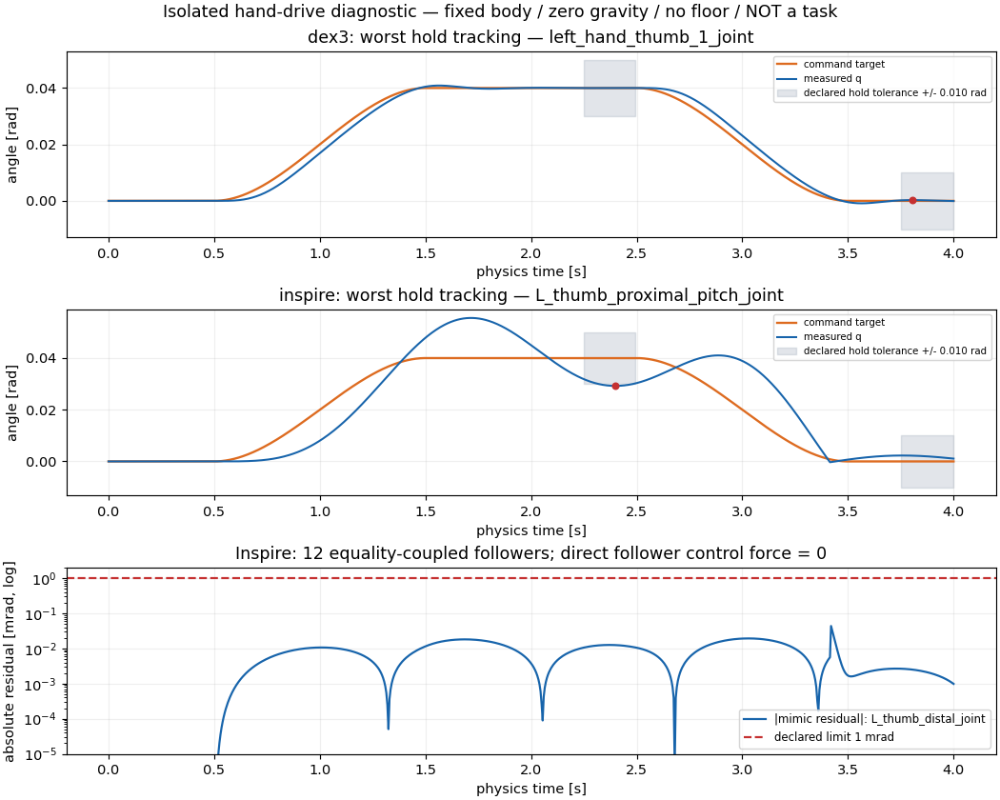

# G1 Dex3 / Inspire：隔离手部驱动与 mimic 实测

两型号各完成一次 800 步、4 秒、801 状态的 Gamma 检查。Dex3 满足本次局部响应条件；Inspire 的左拇指保持跟踪误差超过预声明阈值，因此局部控制器检查未通过。两者均不是 H1 任务成功，也不是完整原始起点见证。

| 项目 | Dex3 · 8036535_0 | Inspire · 8036535_1 |
| --- | --- | --- |
| URDF 非 mimic 手部驱动候选 | 14 | 12 |
| mimic 从属关节 / 实际等式数量 | 0 / 0 | 12 / 12 |
| 全步数据与清单 | 完整 | 完整 |
| 最大实际关节越限，阈值 1 mrad | 0.057231 mrad | 0.740892 mrad |
| 最大速度 / URDF 限值 | 0.019681 | 0.569917 |
| 最大控制力矩 / URDF 限值 | 0.018245 | 0.340259 |
| mimic 最大绝对残差，阈值 1 mrad | 不适用 | 0.043744 mrad |
| 从属关节直接控制力矩 | 不适用 | 全步为零 |
| 驱动保持最大误差，阈值 10 mrad | 0.269624 mrad | **10.776713 mrad，失败** |
| 局部响应条件 | 通过 | 未通过 |
| task_success / full_witness | false / false | false / false |

检查使用新生成的隔离 fixture：29 个身体关节显式锁为 fixed，根节点固定，零重力、无地面。手部原关节 XML、限位和 mimic 标签保留；网格路径仅改为绝对路径。原始 URDF、P4 源码和先前资产检查均未修改。这里的驱动数量来自 URDF 控制候选，不是实机电机数确认，也不能将 Inspire 的全部活动关节当作独立电机。

两个型号均采用 0.005 秒步长、Newton 约束求解器、`disable_constraint=false`、`enable_joint_limit=true`、`sparse_solve=false`；实际解析后的选项、等式关节索引、系数和求解器参数均写入 runtime.json。Genesis 当前导入器把 mimic 关系导入为 JOINT equality；本 fixture 的初始关节坐标和 mimic offset 均为零，实测残差按 `q_follower − multiplier × q_driver − offset` 逐物理步重算。

命令在零位保持后，用三次平滑曲线驱动各非 mimic 关节至限位允许的 `+0.04` 或 `−0.04 rad`，保持再返回零位。每个关节的具体符号、原始角度/速度/力矩限制、phase、KP=20、KV=1 及力矩限幅均在执行前冻结；从属关节只接收零直接控制力，不接受位置或速度命令。此处记录的是实际控制力矩，不是把约束反力解释为电机输出。

## 失败定位与接入含义

- Inspire：`L_thumb_proximal_pitch_joint` 在 **2.400 s** 的目标为 `0.040000 rad`，实测 `0.0292232875 rad`，保持误差 **0.0107767125 rad**，超过 `0.010 rad`。该点处于预声明的末段保持审查窗口，不能用命令已到位替代实测响应。
- Inspire：最大 mimic 残差位于 `L_thumb_distal_joint`，**3.420 s**，`0.0000437436 rad`；最大关节越限也在该关节，**3.415 s**，实测 `−0.0007408916 rad`，下限为零。这两个指标均在本次阈值内。
- Dex3：最差保持跟踪点为 `left_hand_thumb_1_joint`，**3.805 s**，返回零位误差 `0.0002696241 rad`；最大越限位于 `left_hand_middle_0_joint`，**3.475 s**，超过上限零位 `0.0000572309 rad`，均在阈值内。

当前实测说明 Genesis 的 Inspire mimic 导入和耦合在该隔离 fixture 中有效，未发现“从属必须假装独立电机才会动”的缺口。当前未通过的是这套固定 PD 命令的拇指跟踪条件，因此还不能宣布五指控制器接入验收通过。后续控制修正须另行冻结并保留本次失败；本轮每型号仅一次，没有重试。这些结果不证明硬件驱动映射、抓取接触、平衡或任务可解性。

## 图与完整证据

[独立审查 JSON](hand-drive-review.json) · [下载 PNG，140092 字节](hand-drive-diagnostic.png) · [证据清单](hand-drive-evidence/manifest.json) · [绘图源码](hand-drive-evidence/plot_hand_drive.py)。图仅辅助阅读，完整状态是核查依据。

| 模型 | 计划 / 运行选项 / 原始结果 | 完整状态 |
| --- | --- | --- |
| Dex3 | [计划](hand-drive-evidence/8036535_0_dex3/plan.json) · [runtime](hand-drive-evidence/8036535_0_dex3/runtime.json) · [结果](hand-drive-evidence/8036535_0_dex3/result.json) · [日志](hand-drive-evidence/8036535_0_dex3/slurm.log) | [801 状态无损 gzip](hand-drive-evidence/8036535_0_dex3/states.jsonl.gz) |
| Inspire | [计划](hand-drive-evidence/8036535_1_inspire/plan.json) · [runtime](hand-drive-evidence/8036535_1_inspire/runtime.json) · [结果](hand-drive-evidence/8036535_1_inspire/result.json) · [日志](hand-drive-evidence/8036535_1_inspire/slurm.log) | [801 状态无损 gzip](hand-drive-evidence/8036535_1_inspire/states.jsonl.gz) |

[官方 Unitree 固定来源](https://github.com/unitreerobotics/unitree_ros/tree/7919cba47a3f68888f3b084945b0ffbf3bb3763a)及[许可证](hand-drive-evidence/LICENSE-unitree_ros.txt)保留；源 URDF 和派生 fixture 不在网页分发，仅记录本地路径、转换说明及 SHA-256。运行来源、网格、Genesis 关键源码、原始状态和无损压缩均经哈希核验。Dex3 有 3 条凸包惯量警告；Inspire 有 4 条及 2 对中性碰撞过滤，不能据此声称完整碰撞覆盖认证。

本轮 **2 个局部驱动 probe** 与此前 **6 个被动资产 probe** 单列；两者都不进入 H1 任务成功计数。
